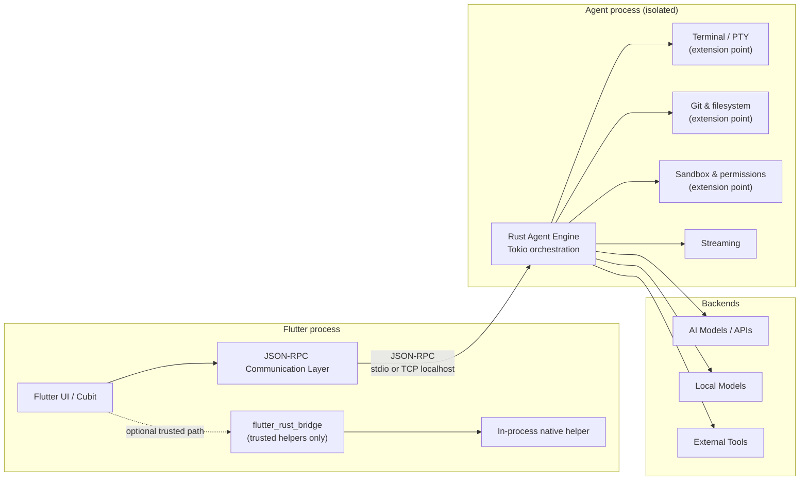

# Agent Communication Layer (demo pattern)

Demo-sized architecture for a Codex/ChatGPT-class Flutter desktop/mobile
client that talks to a **separated agent engine**. This is an architecture
proof, not a full agent product.

Feature: [`agent_comms_demo`](../../apps/mobile/lib/features/agent_comms_demo/).
Engine: [`native/agent_engine`](../../native/agent_engine/).
Change note: [`../changes/2026-10-23_agent_communication_layer_demo.md`](../changes/2026-10-23_agent_communication_layer_demo.md).

## Critical rule

**Untrusted agent commands must not run in the Flutter process.**

Agent orchestration, Terminal/PTY, Git & filesystem mutations, sandbox policy,
and model API traffic belong in an **out-of-process** Rust (or equivalent)
engine. The Flutter UI is a JSON-RPC client. Process isolation provides fault
containment: a hung or crashed agent does not take down the UI isolate.

`flutter_rust_bridge` (FRB) is appropriate only for **trusted in-process
native helpers** (fast crypto helpers, local indexing, encoding). Do not put
the untrusted agent path behind FRB.

## Layer diagram



## Real-world parallel

OpenAI Codex desktop talks to a **Codex App Server** over JSON-RPC. Flutter can
play the same role as a JSON-RPC client: render chat/tool UI, stream events,
and never host the agent runtime in-process.

## When to use what

| Seam | Use when | Demo choice |
| --- | --- | --- |
| JSON-RPC → separate process | Untrusted agent work, sandbox, PTY, long-running tools | **Selected** for the agent path |
| `flutter_rust_bridge` | Trusted helpers needing async/streams/rich types in-process | Documented extension point only |
| Manual `dart:ffi` | Tiny stable C ABI (see [`rust_ffi_secure_core_bridge.md`](rust_ffi_secure_core_bridge.md)) | Secure messaging demo; not this path |
| Dart isolate | Same-process CPU offload; no OS sandbox | Insufficient for untrusted agent commands |

FRB officially supports async Rust, Dart `Future`s, streams, and bidirectional
calls — valuable for trusted helpers. That capability does **not** replace
process isolation for untrusted agent execution.

## Demo surface

| Piece | Role |
| --- | --- |
| `AgentCommsCubit` | Connect / ping / stream events |
| `JsonRpcAgentSession` | Spawns engine, NDJSON JSON-RPC over stdio |
| `native/agent_engine` | Real Rust + Tokio stub (`ping`, `agent/streamDemo`) |
| `tool/agent_engine_dart_stub` | Labeled Dart subprocess fallback (same protocol) |
| Trusted helper port | `TrustedNativeHelper` — extension point for future FRB |

Dev-only route: `/agent-comms-demo` (blocked in prod / release). Not wired into
main product navigation so Example and counter flows stay clean.

## Protocol sketch

Newline-delimited JSON-RPC 2.0 on the child process stdio:

```json
{"jsonrpc":"2.0","id":1,"method":"ping","params":{}}
{"jsonrpc":"2.0","id":1,"result":{"ok":true,"engine":"rust-agent-engine","version":"0.1.0","pid":12345}}
{"jsonrpc":"2.0","method":"agent/event","params":{"type":"progress","message":"..."}}
```

Transport alternatives (same framing): TCP `127.0.0.1` for multi-client debug.

## Extension points (stubs — do not implement full sandbox here)

- **Terminal / PTY** — allocate session, stream bytes, resize, kill
- **Git & filesystem** — scoped workspace roots, read/write/diff
- **Sandbox & permissions** — allowlist tools, deny network/fs by policy
- **Model API client** — cloud providers + local model backends
- **External tools** — MCP / CLI adapters behind the engine

## How to run

```bash
# 1) Prefer Rust engine
cd native/agent_engine && cargo build --release

# 2) Optional: point the demo at the binary
export AGENT_ENGINE_PATH="$(pwd)/target/release/agent_engine"

# 3) Launch app (dev / non-prod flavor) and open /agent-comms-demo
# If AGENT_ENGINE_PATH is unset, the demo falls back to the Dart stub:
#   dart run tool/agent_engine_dart_stub/bin/agent_engine_stub.dart
```

Targeted tests:

```bash
cd apps/mobile
flutter test test/features/agent_comms_demo
```

## Related

- Clean Architecture feature contract: [`feature_structure_contract.md`](feature_structure_contract.md)
- In-process Rust FFI (trusted crypto): [`rust_ffi_secure_core_bridge.md`](rust_ffi_secure_core_bridge.md)
- Feature guide: [`../features/agent_comms_demo.md`](../features/agent_comms_demo.md)
